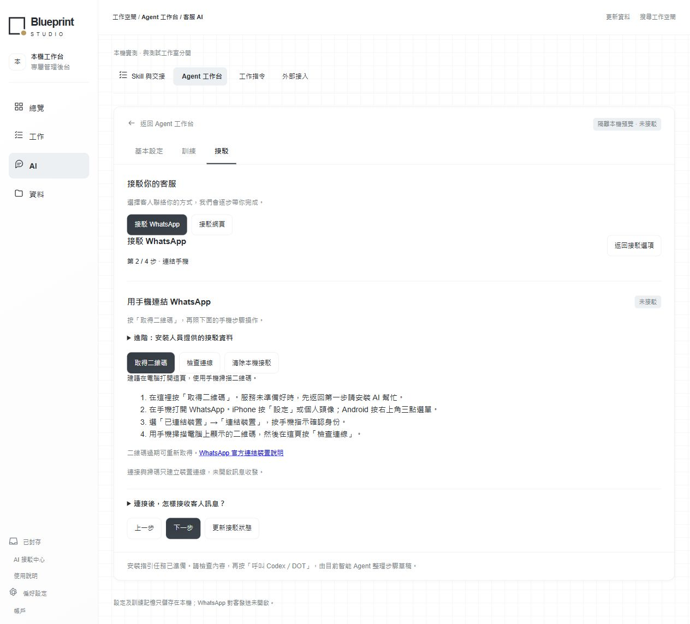

# 0.3.0-preview.1 接駁更新驗證

日期：2026-10-25。來源基準：`aa98256726dd5fd26a6952c11a77c0d69c627f1d`；本版完整來源以 PR head／生成的 `release.json.source.revision` 為準。

## 本機驗證

- Windows、隔離 Node 24.22.0：`npm test` **103／103 通過**，無跳過；`npm run check` 全部 source／public／tools JavaScript 語法通過。
- 原有測試加上 14 項安裝、8 項 WhatsApp runtime、7 項 web-chat 測試，涵蓋真實 HTTP 邊界及暫存 SQLite 重啟。外部 provider 使用明確模擬，不用真實客戶或金鑰。
- 安裝器獨立審查後補上：當前宿主／公司身份綁定、寫入結果與請求設定分開核對、拒絕 `..private` 倉庫內路徑、嚴格能力陣列及備份收據驗證。共用 journal 的 CAS、重跑、waiting_user／resume 及備份 coverage 均有測試。

## 瀏覽器教學驗證

在 `tools/workbench-browser-fixture.js` 的隔離合成環境完成：

| 項目 | 結果 |
| --- | --- |
| 接駁 WhatsApp／接駁網頁兩個入口 | 同一卡片接駁分頁可見並可操作 |
| WhatsApp 四步教學 | 準備、iPhone／Android 掃碼、收件、試收試覆可前後閱讀 |
| 缺少服務資料 | 明確提示返回準備步驟，進階資料自動展開；不被隱藏必填欄位攔截 |
| 網頁服務未開啟 | 沒有虛構網址，複製及開啟入口不提供 |
| 合成 runtime 網頁服務可用 | 顯示真實本機 `/chat` 地址並標示只限同機 |
| 安裝指引任務重跑 | 重複按鍵取回同 ID；取消後重新準備得到新任務 |
| 320 CSS px | 無水平溢出，輸入文字 16px，主要按鍵至少 44px |
| 桌面瀏覽器 | 逐步教學可閱讀，console 無 JavaScript error |
| 真正桌面 200% browser zoom | 此輪工具未能確認，沒有把 pinch scale 或窄視窗當作通過 |

圖片均為合成空白商戶環境：

[320px 手機畫面](../design/evidence/connection-guide-mobile.png)

## 未由這次測試證明的項目

真實 WhatsApp 手機收件、真實帳戶授權、公開 HTTPS 可達性、目前客戶端的原生本人送出，以及私人 Site 安裝均未執行。教學的安裝按鍵只準備指引草稿，不會自行部署或開通帳戶。

原生宿主與 BlueSAI 來源已加入同 ID 套件升級 PATCH／client 及合成檢查；指定運行宿主的能力與真正更新仍需另驗。完整通用 Sites D1／R2 管理 API、原生 renderer、Sites 套件升級適配及宿主共用安裝協調器整合仍待完成。套件提供需求合約、阻擋檢查及可接入的工具；[計劃對應](INSTALL_PACKAGE.md#計劃落地與剩餘相容工作) 明列交付及缺項，不把整份原計劃標為完成。

GitHub Actions 設定 Windows／Ubuntu matrix，針對同一提交測試、只讀 preflight 及生成固定雜湊產物；CI 的實際狀態須按該 PR／提交的執行結果核對，配置 workflow 本身不代表 CI 通過。
