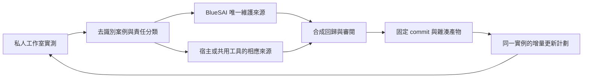

# 統一實測回饋與更新流程

本文件把安裝、使用及升級中發現的問題送回同一份可重用來源，再以固定版本更新各個已授權實例。產品內的人與 AI 工作分工仍以 [HARNESS_ENGINEERING.md](HARNESS_ENGINEERING.md) 為準；這裡處理的是工程回饋、回歸及交付，不另建客服引擎、備份引擎或部署平台。

## 一份來源，按版本交付



每個維護者先指定唯一的 BlueSAI 開發 checkout。工作室載入的是該來源產生的固定版本；測試候選可用隔離 branch／checkout，但不能逐個修改運行目錄，再把多份相似程式互相覆蓋。運行時發現緊急修正，先記錄實際差異、來源與測試，再移回所屬來源，由同一交付流程取代私人補丁。

客服核心、WhatsApp 接駁、宿主適配及登入接駁有不同責任。BlueSAI 維護自身元件與受限 API 合約；宿主維護身份、原生卡片掛載、路由及存取控制。跨項目問題用同一案例關聯各自修正，不把宿主整套程式複製進 BlueSAI。

本機候選已修改、檢查通過、公開包已準備、PR 已提交、上游已發佈、某工作室已部署是不同狀態。任何一項成功都不能自動填上其餘狀態。正式版本不存在時，明確固定 preview commit；不把 `main` 當安裝 pin。

## 「100% 回饋」的可核對意思

先固定本次已知問題清單及範圍，再計算覆蓋。每項已知問題須有穩定 case ID、可重現條件、責任來源、處理決定、對應修正或設定指引、回歸方法及驗收結果。重複出現同一根因時，追加觀察及受影響版本，不另建一套案例。

- **問題已完整登記**：每項觀察都有分類與去向，包含尚未解決及不支援項目。
- **可重用修正已完整回饋**：需要改程式的項目都有對應來源差異及測試；設定問題有可重做的接入指引；宿主問題有相應依賴。
- **某版本已驗收**：要求的檢查均通過，且測試的來源／產物與本次版本相同。
- **某實例已更新完成**：該實例按更新計劃完成資料保留、同 ID 讀回及所要求的真實渠道驗收。

這四個分母不同。所有已知問題都有去向，不表示所有問題已修復，也不保證未來沒有新問題。尚未驗證的瀏覽器縮放、宿主能力或實際送達，要保留明確缺項，不能從報表移除以取得滿分。

## 去識別問題目錄

以下是可重用的問題分類，不記載任何私人實例是否已通過。機器清單在 [feedback/registry.json](../feedback/registry.json)，薄的 runner 接入在 [feedback/harness.json](../feedback/harness.json)，整體案例在 [feedback/installation-loop-001/case.json](../feedback/installation-loop-001/case.json)。同一根因的多次觀察沿用同一 case ID，並引用現有測試，不複製 runner。

| 問題 | 類別與負責來源 | 必須保留的回歸／驗收 |
| --- | --- | --- |
| Windows 打包換行令 inventory 與 commit blob 不同（`bluesai-package-001`） | BlueSAI 打包程式 | 以 commit blob bytes 核對產物；不能修改使用者全域 Git 設定解決 |
| 登入視窗不留在某瀏覽器、登入接駁同源表單問題（`blueprint-login-001`） | 客戶端相容性與登入接駁缺陷分開 | 真正瀏覽器表單、同源保護及原登入保留；一個客戶端失敗不能推論所有客戶端 |
| 卡片操作需要的 HTTP 方法／受限 API 未接通（依賴 `blueprint-bluesai-native-001`、`blueprint-login-001`） | 宿主與登入接駁 | 允許已審閱的受限方法；拒絕跨來源／越權，不把宿主全域 API 代理出去 |
| QR 失效原因遺失、舊圖未清除、編碼競態、515 重試未受限（`bluesai-whatsapp-link-001`） | BlueSAI 接駁與元件 | 安全錯誤原因、舊 socket／舊 QR 拒絕、有界重試；合成測試與真手機配對分開 |
| 登入授權失效後無法重新配對（`bluesai-whatsapp-link-001`） | 維護流程與接駁服務 | 確認程序已停止、核對可恢復資料、保留舊狀態、本人新配對；不能由 401 猜測帳號類型或 SDK 根因 |
| 重開電腦留下舊程序 lease（`bluesai-runtime-recovery-001`） | 本機程序管理 | 核對 owner 已不存在及對應服務狀態；不能只因 PID／檔案存在就刪資料或另啟重複 worker |
| 手機連結成功但沒有客戶來訊（`bluesai-reply-readiness-001`） | 接入設定／教學 | 明確選 test allowlist 或 all-private 收件；固定 webhook 寫入及讀回；同筆真實來訊 |
| 收得到但不能人工回覆（`bluesai-reply-readiness-001`） | 接入設定／回覆 readiness | 知識庫優先的人工模式、獨立渠道發送授權、人工接手及同筆送達；不能代填虛構商戶資料 |
| 加入知識後沒有即時自動答覆（`bluesai-reply-readiness-001`） | 模型／政策／對話狀態需分開 | FAQ 與普通知識、批准與過期、模型真推理、AI 後備及自動發送、新來訊觸發；舊訊息不重跑 |
| 多份安裝摘要互相矛盾（`bluesai-install-state-001`） | 回饋及接續流程 | 有範圍與版本的收據、明確取代關係、由證據產生目前摘要；歷史成功不當目前成功 |
| 重複備份、建卡或部署（`bluesai-install-state-001`） | 既有安裝協調器 | 原 operation／plan 接續、備份 coverage、同 Agent ID／CAS 讀回及不明結果先核對 |
| 更新後原有登入／知識／對話未保留（`bluesai-data-preservation-001`） | 資料與更新契約 | 同實例增量 migration、備份範圍及隔離還原、同記錄讀回；新工作室保持空白 |
| 原生卡片與客服來源逐漸分叉（`bluesai-ui-source-001`） | BlueSAI 元件與宿主適配 | 單一生成來源、產物版本／hash、受限掛載及實際 UI 驗收 |
| 手機版／縮放／未保存輸入尚未驗證（`bluesai-ui-acceptance-001`） | 客服元件與實際宿主 | 320px、真正 200% browser zoom、原生卡片範圍及切換保留輸入；缺項保留待驗 |

不要把真實客戶問題、電話、商戶知識、帳號、instance ID、私人路徑、日誌、截圖或備份加入此表或公開 fixture。公開測試用合成資料；實例觀察與證據在 Git 以外，以私人綁定關聯 case ID。

## 一份共用 runner，沿用安裝生命週期

共用 feedback harness 保持單一維護位置。各項目只提供薄的案例宣告、輸入清單及合成測試；它不讀取運行工作室的資料庫、憑證或對話，不在正式服務 ports 上跑回歸。不能把每個工作室的私人補丁包裝成新的 runner。

本項目的既有檢查仍是：

```sh
npm test
npm run check
node tools/feedback-audit.js
```

`feedback-audit` 是只讀的案例映射與未分類來源差異檢查；它本身不執行或證明回歸通過，也不證明公開發佈或實例已部署。實際檢查結果由共用 runner 或該版本的測試收據提供。runner 使用的 Node 由私人 `--node` 綁定提供給宣告中的 `$NODE`，不把開發者的本機 runtime 路徑寫入公開案例。

安裝能力檢查沿用 `npm run preflight`，固定來源打包沿用 `npm run package:release`；參數與輸出契約見 [INSTALL_PACKAGE.md](INSTALL_PACKAGE.md)。來源或測試改動後，舊結果不能自動覆蓋新版本。

實例變更沿用 `src/install.js` 的 `preflight`、`validateBackupCoverage`、`InstallJournal`，以及 `src/install-blueprint.js` 的 `createBlueprintInstaller(...).ensure(...)`。其階段為：

`preflight → plan → backup_gate → apply → register_or_update → verify → complete`

需要本人操作時記錄 `waiting_user` 及原 `resume_phase`。相同目標、operation ID 與 plan digest 重試要讀回原工作；不同目標或來源／計劃使用新的操作。每次 journal／設定變更使用剛讀回的 `expected_version`。不明發送、下載、備份或登記結果先核對，不直接重做副作用。

`InstallJournal` 是既有階段及 CAS 契約，不是自動備份或部署工具。它只核對收據欄位；真實副本、來源雜湊與還原結果仍由對應協調器驗證。

## 私人收據與目前摘要

每次檢查或副作用完成，保存一筆不可變、具範圍的私人收據。下列是協調契約；實際 adapter 須映射到既有工具支援的欄位，不能假稱 `InstallJournal` 已實作通用事件查詢器。

收據至少關聯 case、實例、操作、計劃摘要、元件、完整來源 pin／產物 hash、相關設定 fingerprint、觀察時間、檢查方式、實際結果及證據摘要。fingerprint 不保存秘密；客戶內容不放在通用收據中。合成測試、工具實測、本人手機確認各自標示，不能互相冒充。

新收據明確指出它取代哪筆同範圍、同能力的舊觀察。較晚的模型成功不會取代舊備份 coverage；較晚收件成功不會自動證明發送。無法判定先後或身份、來源、設定不符時標為需要核對，不能只按檔案修改時間選一份相信。

目前摘要由有效收據產生，保留時間及缺項，不再另外手寫數份互相矛盾的「已完成」檔案。舊收據保留原意，不回頭將先前失敗改成成功。同一來源、輸入、runtime 與檢查契約完全相符時可重用通過結果；有變動只重跑受影響檢查。真實渠道證據有自己的帳戶／程序／授權範圍，不能從另一實例複製。

備份重用先核對資料域、schema、checkpoint、coverage 及可讀還原證據。舊備份可證明當時的恢復能力，不能宣稱它包含之後的新對話、新知識或新手機登入。外部 SQLite／橋接資料與宿主儲存分開核對，資料 schema 以應用實際 migration 契約為準。

## 固定產物更新同一實例

以 [UPDATE_AI.txt](../UPDATE_AI.txt) 開始升級。先比較已安裝來源、目標來源及相容性，再固定經檢查的 commit 和產物雜湊；資料不從開源來源反向同步。各工作室只保存自己的版本、服務與私人資料綁定。

同一工作室保留 Agent ID、原資料位置、登入、知識批准狀態、對話、未完成工作及仍有效的渠道登入。正常停機、依原工具備份／復原、增量 migration、啟動與同記錄讀回形成一次更新。有效登入不強制重新掃碼；重啟後的程序內發送 grant 按真正狀態核對並依既有授權恢復，不能僅由持久設定推斷已可發送。

`ensure` 能處理同版本／同來源的登記去重與設定 CAS，**目前公開宿主合約尚未提供 manifest 原地升級接口**。遇到 `HOST_PACKAGE_UPGRADE_REQUIRED`，先完成並驗證相容宿主的正式升級接口；不能新增另一張卡片、替換整頁或手寫宿主資料表繞過。原有可用實例保持可用，該次升級明確列為受阻。只改客服 runtime 而宿主沒有變更時，不重部署整個宿主。

## 元件來源與更新責任

`design/customer-agent-card-design.html` 是客服卡片的生成來源。需要改標記、元件樣式或內嵌行為時，改該來源再執行 `python tools/build-workbench.py`，核對生成的 `public/agent-card.html`、`public/agent-card.css` 及 `public/workbench.*`。獨立的 HTTP client、handoff 與 inbox tools 依原檔案責任維護；不要將生成內容在宿主再改成另一份。

宿主按 `integrations/blueprint/card-ui.json` 掛載版本化元件及受限 API，記錄使用的客服來源／資產 hash。宿主全域 CSS、導覽、公司資料及身份仍由宿主管理。若整合需要適配，適配只處理既有合約差異，並以合成測試及真正 UI 核對；不能把舊整頁診斷介面當交付物。

每次交付至少回答：哪些 case 已涵蓋、哪些仍受阻、固定來源與產物是甚麼、檢查依據屬哪個版本、哪些實例真正更新、同 ID／資料與渠道是否讀回。只有這些都對得上，才將該實例的這次更新標為完成。

## 同一對話的人工與自動模式驗收

保留「AI」、「交回知識庫／AI」與「開始人工回覆」所表達的單一對話模式切換。這是本人接手與恢復自動處理的流程，不是資料庫交換、匯出或建立另一個客戶紀錄。按鈕文案可依實際 FAQ-only／模型可用模式顯示，但不能失去下列契約：

- 同一 conversation 的訊息與歷史持續讀回，切換模式不複製對話或搬移知識。
- 人工接手阻擋該對話的 AI 自動發送，保留尚未送出的人工文字。
- 只有明確交回才恢復自動處理，並由下一則新來訊觸發；不回跑舊問題。
- FAQ、真正模型回覆、人工提交及手機送達分開驗收，控制狀態與全域政策分開顯示。

這項操作契約歸 `bluesai-reply-readiness-001` 與 `bluesai-ui-acceptance-001`，不用為它另建資料交換功能。

### 共用 runner 呼叫

下列變數只由本機提供，私人 state 必須在所有 Git checkout 以外。宣告中的 source_revision 是回饋比較基線；真正候選由全部輸入雜湊、私人 commit 收據及固定產物辨識。

```powershell
python -B -X utf8 $env:SHARED_HARNESS plan --project-root $env:BLUESAI_SOURCE --adapter feedback/harness.json --case feedback/installation-loop-001/case.json --state $env:PRIVATE_STATE --operation installation-loop-001 --node $env:NODE_EXECUTABLE
python -B -X utf8 $env:SHARED_HARNESS status --state $env:PRIVATE_STATE
```

按 harness.json 的 checks 逐項執行 `run --state $env:PRIVATE_STATE --check <check-id>`；Node 測試採與 npm test 相同的完整檔案集合，分成四組，以維持每項最多 300 秒。每項均宣告整個來源輸入，新增檔案要更新清單；相同輸入通過後重跑會讀回原收據。用 `bundle` 準備 allowlist 交接包，不會推送或部署。CI 直接執行 npm test、npm run check、feedback:audit 與 relink 回歸。
